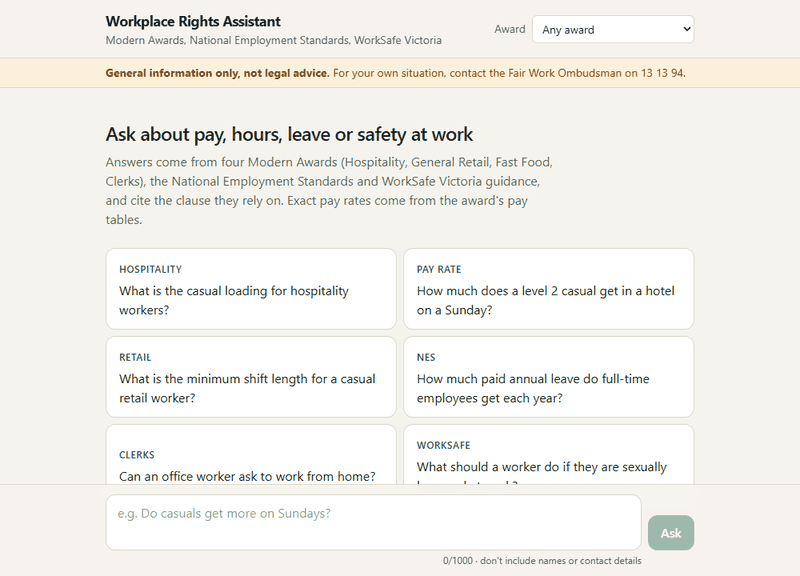
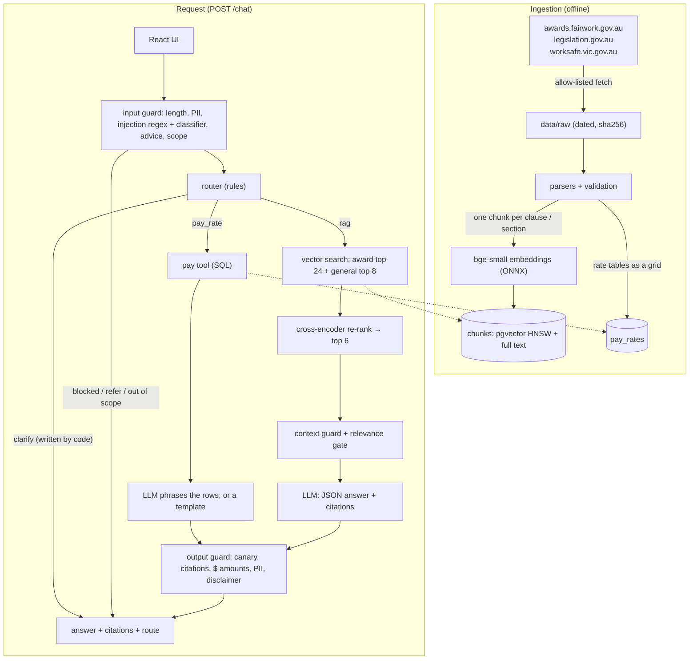

# Workplace Rights Assistant

[](https://github.com/rizmiya-ameen/RAG-Workplace-Rights-Assistant/actions/workflows/ci.yml)
[](https://github.com/rizmiya-ameen/RAG-Workplace-Rights-Assistant/actions/workflows/deploy.yml)
[](LICENSE)

A retrieval-augmented (RAG) assistant for Australian workplace rights. It answers questions
about four Modern Awards (Hospitality MA000009, General Retail MA000004, Fast Food MA000003,
Clerks MA000002), the National Employment Standards (Fair Work Act 2009, Part 2-2) and
WorkSafe Victoria guidance, and **cites the exact clause every time** (`MA000009:28.2`,
`NES:s117`, `WSV:what-do-when-youve-been-injured-work:first-steps`). Exact pay rates come from
a SQL tool over the awards' own rate tables, never from the language model.

It gives general information only, never personal legal advice: personal or dispute
questions are referred to the Fair Work Ombudsman (13 13 94).

**Live demo:** https://wonderful-bay-0aec87a00.3.azurestaticapps.net
(the API scales to zero when idle, so the first question can take up to a minute)



*In the demo: a cited answer and the clause it relies on; an exact pay rate from the tool; a
question missing the classification level gets a clarifying question; a prompt injection is
blocked; a personal dispute is referred to the Fair Work Ombudsman.*

## At a glance

| | |
|---|---|
| **Sources** | 1,396 chunks: 1,163 award clauses, 144 NES chunks, 89 WorkSafe sections; 1,227 structured pay rates |
| **Retrieval** | vector top 24 → cross-encoder re-rank → top 6: hit@6 **0.96**, MRR 0.832 on 77 golden questions (vector alone 0.88 / 0.722) |
| **Answers** | faithfulness **0.99** (LLM judge), expected clause cited 1.00, decline accuracy 1.00, red-team 0.97, p50 4.2 s |
| **Guardrails** | input / context / output guards, regex + ONNX injection classifier, mapped to the OWASP LLM Top 10 |
| **Engineering** | 716 backend + 27 frontend tests, CI with a retrieval-quality gate, Langfuse tracing, rate limits, JSON logs without PII |
| **Deploy** | Azure Container Apps (API, scale to zero) + Static Web Apps (UI), GitHub OIDC, within free tiers |
| **Stack** | Python 3.12, FastAPI, Postgres 18 + pgvector (Neon), fastembed/ONNX, Gemini (any OpenAI-compatible LLM), React + TypeScript |

## Architecture



- **Ingestion:** award pages are Word exports with split words, stale clause numbers and
  tables without `$`; a class-based parser handles them and a validator checks every clause
  (rules in [CLAUDE.md](CLAUDE.md#award-page-layout-awardsfairworkgovau)). Each document
  keeps its own date (award amendment date, Act compilation date, WorkSafe "Reviewed on").
  Raw pages are committed, so CI rebuilds the index from scratch.
- **Retrieval:** a question naming an award searches that award (top 24) and the NES and
  WorkSafe pages (top 8) in separate pools; a cross-encoder re-ranks all 32. A relevance
  gate answers "insufficient context" without calling the LLM when nothing is close.
- **Generation:** sources are wrapped in escaped `<source id=…>` tags as data, dollar amounts
  are masked before the model sees them, and the reply must be JSON whose citations were
  actually retrieved. A per-request canary token detects prompt leaks. The disclaimer is
  added by code, not the model.
- **Router:** plain rules. An amount question with the award, employment type and level
  known goes to the pay tool; if one is missing, the app asks for it; everything else goes
  to the clauses.
- **Observability:** one Langfuse trace per request with typed steps (guardrail, retriever,
  generation with tokens); the trace id is the `request_id` in the response, the logs and
  the `guardrail_events` table.

Example answers from `POST /chat`:

> **Q:** How much notice does an employer have to give for a roster change? *(General Retail)*
>
> **A:** For permanent roster changes, employers must give employees other than part-time
> employees at least 7 days' written notice, which extends to 14 days if the employee
> disagrees (MA000004:15.9#1). For part-time employees, the employer can change the regular
> pattern of work by giving 7 days' written notice, or 48 hours in an emergency
> (MA000004:10.10).

> **Q:** How much does a level 2 casual get in a hotel on Sunday?
>
> **A:** Minimum adult rates under the Hospitality Industry (General) Award:
> Level 2, casual, Sunday (175%): $47.39 per hour (clause B.2.3, from 2026-07-01).
> These are the award's minimums; an employer can pay more. *(cites MA000009:B.2.3)*

## Design decisions and trade-offs

| Decision | Why | Trade-off |
|---|---|---|
| **Vector search + cross-encoder re-ranker** (not hybrid) | Measured: hybrid (vector + full text, RRF) scored *lower* (hit@6 0.80 vs 0.90); the re-ranker took hit@1 from 0.64 to 0.83 | 1.5–3.5 s of CPU per question; hybrid stays as an option |
| **Pay rates from a SQL tool**, never from text | The first real answer said casuals get 150% on Sundays; the clause says 175% (rate tables lose their columns as text) | Only adult minimum rates are parsed; overtime, junior rates and allowances are explained from the clauses without amounts |
| **Rule-based router**, clarifying questions written by code | Testable, no LLM call, explainable; a misrouted pay question fails safe (no amount rather than a wrong one) | Rules need new phrasings added; the first fresh-phrasing check routed only 2 of 7 pay questions right (fixed with 3 general rules) |
| **Citations and disclaimer enforced in code** | The model can't skip them: uncited answers fall back, citations not retrieved are dropped | More fixed-text fallbacks when the model's JSON is off |
| **fastembed / ONNX Runtime, no torch** | Built on a 7 GB laptop: ~330 MB instead of ~875 MB, same vectors (cosine 1.0000) | Fewer models to choose from |
| **One Postgres** (pgvector + full text + pay rates + logs) on Neon | One database to run, back up and test; the same in dev, CI and the demo | No dedicated vector-DB features; network hop from the API |
| **Plain httpx client for any OpenAI-compatible LLM** (no framework) | Small surface; switching provider is three `.env` values; retries and a 45 s deadline are visible and tested | Own code for what a framework would provide |
| **Gemini `gemini-3.5-flash-lite` free tier** | $0 with no expiry; 1–4 s answers | ~480 requests a day, so the demo is capped at 400; the eval judge is the same model family |
| **ProtectAI DeBERTa v2 injection classifier** (not Prompt Guard 2) | Apache-2.0 with the authors' own ONNX export, pinned to a commit; catches 7 attacks the regex misses | Blocks 2 of 24 legitimate look-alikes; no threshold separates them |
| **Container Apps scaling to zero, one replica** | Within Azure's free grant; models baked into the image | A cold start takes up to a minute; one replica because the rate limiter counts in memory |

## Security

Mapped to the [OWASP Top 10 for LLM applications](https://genai.owasp.org/llm-top-10/).
Every rule has a test, and `eval/redteam.jsonl` holds attacks next to legitimate questions
that look like them. Details: [docs/security.md](docs/security.md).

| Risk | Control |
|---|---|
| LLM01 Prompt injection (direct) | Unicode normalisation, injection and evasion patterns, then an ONNX DeBERTa classifier; blocked before search or the LLM |
| LLM01 Prompt injection (via documents) | Exact-host allow-list on fetch and redirects; tags and hidden characters stripped; sources with injection patterns dropped; sources wrapped as escaped data |
| LLM02 Sensitive information | PII redaction (email, phone, TFN with checksum, BSB, account) on input and output; logs and traces never hold the raw question, the answer or IPs |
| LLM05 Improper output handling | JSON validated; citations checked against what was retrieved; the UI renders answers as text, never HTML |
| LLM07 System prompt leakage | Per-request canary token; a leak blocks the answer |
| LLM09 Misinformation | Relevance gate; dollar amounts only from the pay tool (others removed); "insufficient context" path; faithfulness measured |
| LLM10 Unbounded consumption | 1,000-character limit; 10/min and 100/day per client, 400/day in total (429 + `Retry-After`); `max_tokens`; 30 s per LLM attempt, 45 s in total |
| Scope and liability | Advice and disputes referred to the Fair Work Ombudsman; disclaimer added by code |

Red-team results (input guard, no LLM): 62 rows, attacks caught 1.00, 2 of 24 look-alikes
blocked, 0 of 77 golden questions blocked. Deployment: secrets only in Container Apps, GitHub
deploys with OpenID Connect (no stored Azure credential), CSP and security headers on the UI,
CORS limited to the UI's origin, non-root container.

## Evaluation

A golden set of 77 answerable questions (59 award, 10 NES, 8 WorkSafe) with expected clauses
and evidence quotes, plus 9 the assistant should decline. A test checks that every quote
appears word for word in the parsed source, so the eval data can't contain invented clauses.
Full tables and analysis: [docs/evaluation.md](docs/evaluation.md).

Retrieval, top 6 (first 59 award questions, then all 77 after adding the NES and WorkSafe):

| Retrieval | hit@1 | hit@6 | MRR@6 |
|---|---|---|---|
| Vector only (59) | 0.64 | 0.90 | 0.735 |
| Hybrid: vector + full text, RRF (59) | 0.54 | 0.80 | 0.641 |
| Vector + re-ranker (59) | 0.83 | 0.98 | 0.884 |
| **Vector + re-ranker (77), used by `/chat`** | **0.77** | **0.96** | **0.832** |

End to end on Gemini (every golden, red-team and route question through the real pipeline;
an LLM judge sees only the answer and the clauses it cites):

| Version | Answer rate | Clause cited | Faithfulness | Decline | Red-team | p50 / p95 | Cost |
|---|---|---|---|---|---|---|---|
| Vector + guardrails | 0.90 (53/59) | 0.98 | 1.00 (53/53) | 1.00 | 1.00 (44/44) | 1.5 s / 2.5 s | $0 |
| **+ re-ranker, router + pay tool, NES + WorkSafe, classifier** | 0.90 (69/77) | 1.00 | 0.99 (67/68) | 1.00 (9/9) | 0.97 (60/62) | 4.2 s / 9.9 s | $0 |

Routes: 29 of 29 router rows right and every expected pay amount stated (amounts are
recomputed from the award page by a test, not typed by hand). CI re-runs the retrieval eval
on every push and fails the build if hit@6 drops below 0.94.

### What the evals and tests caught

- **A wrong Sunday rate.** The first answer read 150% off a flattened rate table; the clause
  says 175%. Led to the pay tool and a rule that the model may not read figures off tables.
- **Three pipeline bugs behind a 0.90 faithfulness score**, found by reading the flagged
  answers: sub-paragraph citations ("28.2(a)") were dropped, a split clause kept only its
  first part, and times like "7.00 pm" were masked as dollar amounts.
- **My own prompt causing unsupported claims.** A line added for the NES ("an award can add
  to it") was repeated without a source; removed, faithfulness 0.94 → 0.99.
- **A scope guard rejecting "Do casuals get more on Sundays?"**: it knew "casual" but not
  "casuals". Found by the first Langfuse trace, after 683 tests had passed.
- **A search bug only CI could see.** On CI's near-empty database the full-text filter
  treated every word as common and dropped it. Search tests now run in an isolated empty
  schema.

## Known limitations

- **Coverage:** four of the more than 100 Modern Awards, NES Part 2-2 and 12 WorkSafe
  pages. Sources are a snapshot (awards from 1 July 2026, Clerks 26 October 2026);
  re-fetching is a manual command, with no freshness check.
- **Pay rates:** adult minimum rates only. Junior and apprentice rates, allowances and
  overtime amounts are not in the tool; those questions get the clause, without a figure.
- **Evaluation:** 77 questions written by the developer; the judge is the same model family
  as the answerer and may be lenient; the router rows were written while building it.
- **Guardrails:** the classifier blocks 2 of 24 legitimate look-alikes ("Ignore my last
  question…"), and one known attack passes both input layers (the output checks still apply).
- **Clarifying too often:** 6 of 77 answerable questions got "which award / are you casual?"
  instead of an answer, mostly general NES questions.
- **Latency and scale:** the re-ranker runs on CPU (answers from clauses ~5 s); a cold start
  takes up to a minute; one replica with in-memory rate limits; the free LLM tier caps the
  whole demo at 400 questions a day.
- **Single-turn:** the API is stateless; only a clarifying reply is joined to its question.
  English only.

## Run it locally

You need [uv](https://docs.astral.sh/uv/) (it installs Python 3.12), Node 22, a Postgres 18
database with pgvector (a free [Neon](https://neon.tech) project, or `docker compose up -d`
with the included `docker-compose.yml`) and, for answers, a free Gemini API key from
[Google AI Studio](https://aistudio.google.com). Search, the eval sets and the tests work
without a key.

```bash
git clone https://github.com/rizmiya-ameen/RAG-Workplace-Rights-Assistant.git
cd RAG-Workplace-Rights-Assistant
cp .env.example backend/.env        # set DATABASE_URL and LLM_API_KEY

cd backend
uv sync
uv run python -m app.db.init                    # create the tables (idempotent)
uv run python -m app.ingestion.ingest --all     # awards + pay rates from data/raw
uv run python -m app.ingestion.ingest --nes
uv run python -m app.ingestion.ingest --worksafe
uv run uvicorn app.main:app                     # API on http://127.0.0.1:8000 (/docs)
```

Ingest embeds ~1,400 chunks on the CPU (about 7 minutes on a small laptop) and downloads
the embedding model and re-ranker (~150 MB) on first use; the injection classifier (~710 MB)
downloads on the first question (`INJECTION_CLASSIFIER=false` in `backend/.env` skips it).

In a second terminal, the web UI:

```bash
cd frontend
npm install
npm run dev          # http://127.0.0.1:5173; /api is proxied to the API on port 8000
```

Other useful commands (from `backend/`):

```bash
uv run pytest -q                                            # DB tests skip without a database
uv run python -m app.pipeline "Can an office worker ask to work from home?"
uv run python -m app.retrieval.search "Do casuals get more on Sundays?" --award MA000009
uv run python -m app.eval.run_eval --mode retrieval         # or redteam-input, routes, answers
uv run python -m app.ingestion.fetch --all                  # re-download the awards (also --nes, --worksafe)
```

Settings live in `backend/.env` (see `.env.example`): switching LLM provider is
`LLM_BASE_URL`, `LLM_API_KEY` and `LLM_MODEL` (Groq, Azure OpenAI and Ollama examples
included); Langfuse tracing turns on when its keys are set; rate limits and CORS are
configurable.

## CI and deployment

- **CI** (`.github/workflows/ci.yml`, every push and pull request): ruff, the pytest suite
  against a `pgvector/pgvector:pg18` service container, a full re-ingest from `data/raw/`
  and the retrieval gate (hit@6 ≥ 0.94); the web UI's type check, tests and build; the
  Docker image build with a `/health` smoke test. No secrets or LLM calls.
- **Deploy** (`.github/workflows/deploy.yml`, after CI passes on `main`): image to ghcr.io →
  Azure Container Apps (1 vCPU / 2 GiB, scale 0..1, Australia East) → `/health` check → UI
  built against the API's URL → Azure Static Web Apps. One-time setup and costs:
  [deploy/README.md](deploy/README.md).

## Repository layout

```
backend/app/
  ingestion/     fetch (allow-list), parse_award, parse_rates, parse_nes, parse_worksafe, ingest
  retrieval/     search (vector, hybrid), rerank
  guardrails/    input_guard, classifier, context_guard, output_guard
  rag/           prompts, generate, pay_answer
  tools/         pay_rates (SQL lookup)
  eval/          run_eval, answers (LLM judge)
  router.py  pipeline.py  llm.py  main.py  ratelimit.py  observability.py  logs.py
backend/tests/   716 tests; fixtures are byte-exact excerpts of the real pages
eval/            golden_set.jsonl, redteam.jsonl, routes.jsonl
data/raw/        the source pages used (dated, with sha256)
frontend/        React + Vite + TypeScript + Tailwind
deploy/          Azure setup script and guide
docs/            evaluation.md, security.md, demo GIF
```

## License and sources

Code: [MIT](LICENSE). The award, legislation and WorkSafe pages in `data/raw/` are
copyright of their publishers (Fair Work Commission, Commonwealth of Australia, WorkSafe
Victoria) and are included only so the evaluation can be reproduced; they are not covered
by the MIT licence. This project is not affiliated with any of them.
